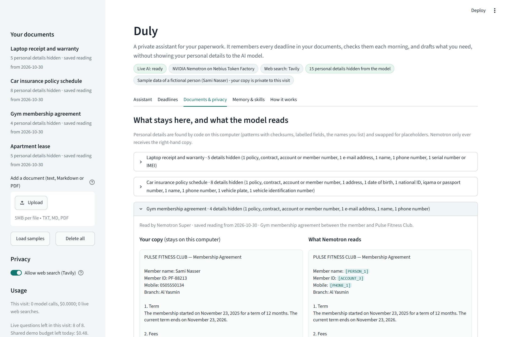
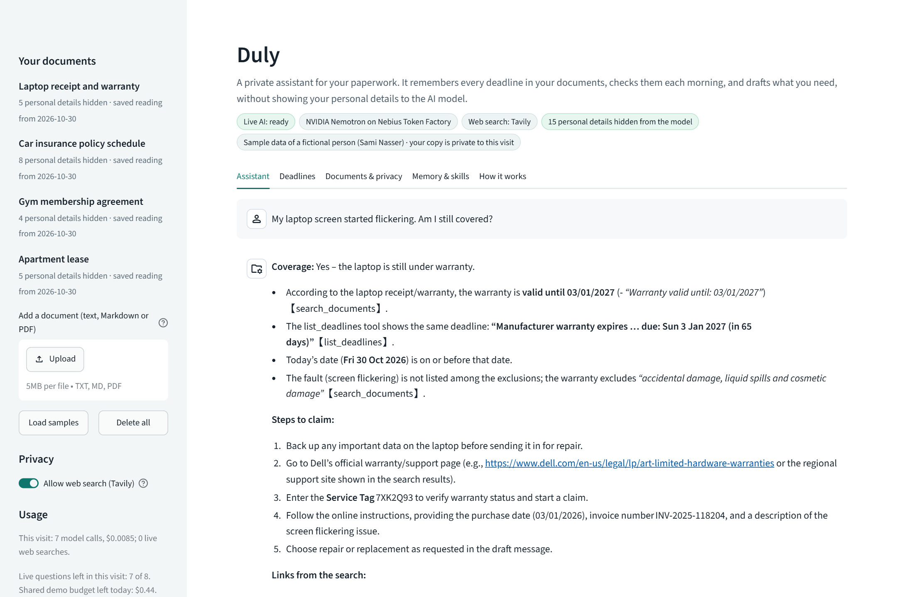
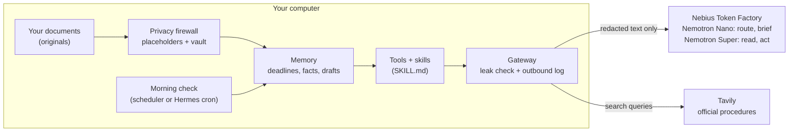

# Duly: a private assistant for your paperwork

**Duly reads your contracts, policies, receipts and memberships, keeps every deadline, checks them each morning,
and drafts what you need. The AI model never sees your personal details.**

Built for the Nebius x NVIDIA Global AI Hackathon, Personal AI track.

- Live demo: `<demo URL>` (if the demo is asleep, click the wake-up button and wait about 30 s)
- Video: `<YouTube URL>`
- License: [MIT](LICENSE)



## The problem

Paperwork deadlines cost real money, and the help people reach for today costs them their privacy.

- **Deadlines slip.** In a C+R Research survey of 1,000 consumers, 42% said they had forgotten they were still being
  charged for a subscription they no longer use ([CNBC, June 2022](https://www.nbcwashington.com/news/business/money-report/consumers-spend-an-average-133-more-each-month-on-subscriptions-than-they-realize-study-shows/3067565/)).
  Auto-renewals, notice periods, warranty ends and policy expiries hide in documents nobody rereads.
- **AI help means handing over personal data.** In Cisco's 2024 Consumer Privacy Survey (2,600 consumers in 12
  countries), 30% of generative AI users said they enter personal or confidential information, including financial
  and health details, into AI tools, despite 84% being concerned about that data going public
  ([Cisco, Oct 2024](https://newsroom.cisco.com/c/r/newsroom/en/us/a/y2024/m10/cisco-survey-shows-strong-relationship-between-privacy-awareness-and-trust-in-ai.html)).

Duly is an assistant you can give your paperwork to, because your names, ID numbers, IBANs, phone numbers and
policy numbers are removed on your own computer before anything reaches the model.

## What Duly does

1. **Reads your documents** (text, Markdown or PDF) and keeps every dated obligation: renewals, expiries, payments
   due, notice periods, warranty ends. Each date is shown with the document's own words.
2. **Checks them every morning** and tells you what needs action, most urgent first, including what renews
   automatically if you do nothing.
3. **Does the work** when you ask: is my laptop still under warranty, how do I cancel the gym before it renews, how
   do I renew my car insurance without a gap, what is due this month. It follows a skill for each task, finds the
   official procedure on the web, and saves drafts and reminders for you to review. It never sends anything.
4. **Remembers** what you tell it, forgets on request, and exports your deadlines to your calendar.
5. **Shows its privacy work**: your copy of each document next to the copy the model reads, the placeholder vault,
   and a log of every call that left your computer, with the exact text that was sent.



## How it works



- **Privacy firewall (local code, no model).** Detectors for IBANs and payment cards (with mod-97 and Luhn
  checksums), e-mail addresses, phone numbers, Saudi national ID and iqama numbers, VINs, labelled fields such as
  *Policy number*, *Address* or *Date of birth* (also in tables), and the names in your profile. Each value becomes a
  placeholder such as `[PERSON_1]`; the same value always gets the same placeholder. Company names, dates and amounts
  are kept, because the assistant needs them.
- **One way out.** Every model call and web search goes through `duly/gateway.py`, which blocks the call if any value
  from the vault is in the payload, and logs the exact text sent.
- **The model never writes a date.** Code finds every date written in a document (with the document's day/month
  convention) and numbers them; Nemotron Super only says which dates matter and what each means, in a strict JSON
  schema. A notice period counts only if code finds the number of days in a sentence of the document.
- **Skills with guarantees.** Procedures live in the open Agent Skills format (`skills/<name>/SKILL.md`). Nemotron
  Nano picks the skill; Nemotron Super follows it; Duly does not accept an answer until the skill's required tools
  (for example the web search and the draft) have really been called.
- **No invented links.** A link or e-mail address in an answer must appear in a document or a search result of that
  turn; any other is removed, and the answer says so.
- **Always on.** `scripts/morning.py` runs the morning check from Windows Task Scheduler or cron. The same tools are
  an MCP server, so Hermes Agent can use Duly from Telegram or its own scheduler.

## How we use NVIDIA Nemotron

| Model (on Nebius Token Factory) | Job in Duly | Why this model | Measured (30 Oct 2026) |
|---|---|---|---|
| `nvidia/NVIDIA-Nemotron-3-Nano-30B-A3B` | picks the skill for each question; writes the morning brief | small and fast for short, structured jobs | about 1 s and $0.00002 per routing call |
| `nvidia/nemotron-3-super-120b-a12b` | reads each document into dated obligations (JSON schema); runs the assistant with tool calling | reliable tool calling and structured output | 2.2 s and $0.0006 per document; 4 to 15 s and $0.002 to $0.010 per question |

Lessons from building on them, also in our feedback:

- With reasoning switched off, Super started its answer with the list and the strict JSON schema pushed that text
  into the `summary` field. Brief reasoning (`low_effort`) gave clean JSON.
- The model's reasoning does not see the JSON schema (only the decoder does). Spelling out the exact output shape
  in the prompt stopped empty constrained answers.
- When Super wrote dates itself, it read `03/01/2027` as 1 March and subtracted a notice period twice. That is why
  code now finds the dates and the model only labels them.

## How Nebius Token Factory helped

- One OpenAI-compatible endpoint serves both model sizes, so each job goes to the smallest model that does it
  well: Nano routes and writes, Super reads and acts. Switching a role is one line in `config.yaml`.
- Tool calling and strict JSON-schema output worked on Super through the standard OpenAI SDK, with no special client.
- Usage is metered from each response, so Duly shows the tokens, latency and cost of every step, and the public demo
  enforces daily and total spend caps.
- Hermes Agent ships a built-in Nebius Token Factory provider, which makes Duly's MCP tools usable from Hermes with
  the same models.

**Other Nebius tools:** none besides Token Factory.

## How we use Tavily

Tavily finds the official procedure for the task at hand: the manufacturer's warranty claim pages, an insurer's
renewal steps, a provider's cancellation rules. Search queries pass the same privacy check as model calls, results
are cached for a day, and each source is labelled *via Tavily (live)* or *(cached)*. Because links in an answer must
come from a search result, Tavily is what lets the assistant give links at all.

## Results

Live run on the four fictional sample documents (`python scripts/evaluate.py --reads 3 --asks 2`, 30 Oct 2026,
57 model calls, $0.06 in total). The full table is in [eval/results.md](eval/results.md).

| Measure | Result |
|---|---|
| Deadlines found with the right date and notice period | 18 of 18 (12 document reads) |
| Extra items, items flagged "check this" | 0, 0 |
| Questions answered with the right skill | 8 of 8 |
| Runs where the skill's required tools were really used | 8 of 8 (1 needed Duly's reminder) |
| Calls blocked by the privacy check, links removed | 0, 0 |

Limits of this evaluation: four documents written for the demo, in English, with clean text. Real documents are
messier; that is why every date shows its source sentence and unverified items are flagged.

## Use Duly from Hermes Agent (MCP)

Duly's tools run as an MCP server over stdio:

```bash
python -m duly.mcp_server
```

In Hermes Agent, choose the Nebius Token Factory provider (`hermes model`, with `NEBIUS_API_KEY` set) and add Duly
to `~/.hermes/config.yaml`:

```yaml
mcp_servers:
  duly:
    command: "/path/to/duly/.venv/bin/python"     # .venv\Scripts\python.exe on Windows
    args: ["-m", "duly.mcp_server"]
    env:
      DULY_DATA_DIR: "/path/to/your/duly-data"
```

The tools return the same redacted text Duly's own assistant sees, so documents keep their placeholders. What you
type to Hermes yourself does not pass through Duly's firewall. The `skills/` folders use the same SKILL.md format
that Hermes reads.

Tested: the server's seven tools answer an MCP client (the MCP Python SDK over stdio) with redacted results. Not yet
tested inside Hermes Agent itself in this build.

## Run it locally

Prerequisites: Python 3.11 or newer, a Nebius Token Factory API key, a Tavily API key.

```bash
git clone https://github.com/Rashed-Almasri5505/duly.git
cd duly
python -m venv .venv
.venv\Scripts\activate            # Windows; on macOS/Linux: source .venv/bin/activate
pip install -r requirements.txt
cp .env.example .env              # Windows: copy .env.example .env, then add your two keys
streamlit run app.py
```

Then add your own documents in the sidebar, or click **Load samples**. Your data stays in `data/user` (or
`DULY_DATA_DIR`), which git ignores.

Other commands:

```bash
pytest                                                   # 22 tests, no network
python scripts/smoke_test.py                             # checks the models and Tavily (under one cent)
python scripts/ask.py "What do I need to do in the next 30 days?"
python scripts/morning.py                                # the morning check; schedule it once (see the file)
python scripts/evaluate.py                               # the live evaluation above (about $0.10)
python scripts/run_demo.py                               # the app as hosted: samples, private per visit
```

## Deployment notes

The public demo runs on Streamlit Community Cloud with `DULY_DEMO_MODE=1`: every visitor gets a private, temporary
copy of the fictional sample documents (deleted after a day), and live use is capped per visit and per day. If live
AI is paused (a cap is reached or a service is down), the app shows conversations recorded live with the same
samples, labelled with their date. Community Cloud apps sleep when unused: click the wake-up button and wait about
30 seconds.

## Project structure

```
app.py                  Streamlit app
config.yaml             models, prices, limits
duly/privacy.py         detectors, vault, leak check
duly/gateway.py         the only way out: model calls and Tavily searches, checked and logged
duly/reader.py          document -> dated obligations (code finds dates, Nemotron Super labels them)
duly/agent.py           the assistant loop: Nano routes, Super acts, skill steps enforced, links grounded
duly/tools.py           the assistant's tools
duly/store.py           memory: documents, obligations, facts, drafts, outbound log
duly/brief.py           the morning check
duly/ics.py             calendar export
duly/mcp_server.py      MCP server for Hermes Agent and other MCP clients
skills/                 Agent Skills (SKILL.md)
samples/                fictional documents, dated relative to today, and a recorded reading
data/replays/           conversations recorded live, for offline mode
scripts/                smoke test, CLI, morning check, evaluation, recorders
tests/                  22 tests
eval/                   evaluation results
```

## Limitations and next steps

- Personal details are found by rules. A name that is neither labelled nor in your profile can be missed; the
  side-by-side view and the outbound log make that visible.
- Duly reads text and PDFs with a text layer; scanned images need OCR, which is next.
- The model provider still receives the redacted text (dates, amounts, company names).
  Next: run Nemotron Nano on the user's own GPU for the reading step, and run Duly inside an NVIDIA OpenShell sandbox
  (through NemoClaw) whose network policy allows only Token Factory and Tavily.
- Duly drafts but never sends, and it does not give legal or financial advice.

## License and acknowledgements

MIT, see [LICENSE](LICENSE). Built with NVIDIA Nemotron on Nebius Token Factory, Tavily, Streamlit, Plotly, pydantic,
pypdf, the OpenAI Python SDK and the MCP Python SDK. All names, numbers and addresses in `samples/` are invented.
